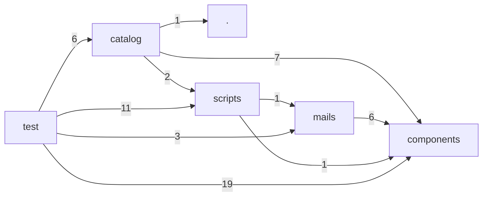

# Layers

## components

| Forbidden import                                                                             | Message                                                                                                                                                                                                                                                                                |
| -------------------------------------------------------------------------------------------- | -------------------------------------------------------------------------------------------------------------------------------------------------------------------------------------------------------------------------------------------------------------------------------------- |
| `^(\./)*(\.\./)+(mails\|scripts\|catalog)(/\|$)\|^@hackersandwizards/mail/(mails/\|render$)` | `components/** cannot import from mails/, scripts/, catalog/, or @hackersandwizards/mail/(mails\|render). Pass composed content or data in as props from mails/, and keep shared tokens and helpers in components/ (such as components/theme.ts). Do not silence with oxlint-disable.` |

## mails

| Forbidden import                                                            | Message                                                                                                                                                                                                                                                                                                     |
| --------------------------------------------------------------------------- | ----------------------------------------------------------------------------------------------------------------------------------------------------------------------------------------------------------------------------------------------------------------------------------------------------------- |
| `^(\./)*(\.\./)+(scripts\|catalog)(/\|$)\|^@hackersandwizards/mail/render$` | `mails/** cannot import from scripts/, catalog/, or @hackersandwizards/mail/render. Keep mails/ as pure compositions over components/, move shared helpers or types into components/ or mails/, and leave rendering or preview logic in scripts/render.ts or catalog/. Do not silence with oxlint-disable.` |
